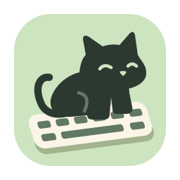
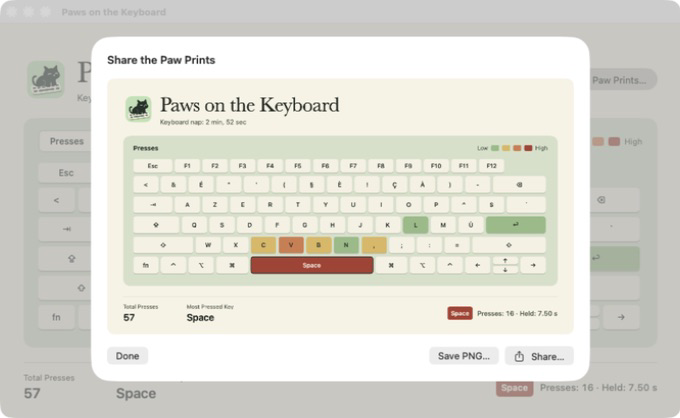

# Cat Is Coming



Your cat has found the warmest seat in the house. It has 79 buttons.

**Cat Is Coming** is a small macOS menu bar app that locks your keyboard, mouse, or both while your cat settles in. Mouse lock freezes the pointer and blocks clicks, drags, and scrolling from your mouse or trackpad.

## Build and run

You’ll need **macOS 13 or later** and **Xcode 26** to build from source. Open `CatIsComing.xcodeproj` and run the **CatIsComing** scheme with **⌘R**, or use Terminal.

```sh
xcodebuild -project CatIsComing.xcodeproj -scheme CatIsComing -configuration Debug -derivedDataPath build build
open "build/Build/Products/Debug/Cat Is Coming.app"
```

On first launch, Cat Is Coming asks for Accessibility so it can lock your keyboard and mouse. Enable **Cat Is Coming** under **System Settings › Privacy & Security › Accessibility**. The app detects the change automatically. If you close the setup window, you can pick up from the cat menu with **Allow Input Locking…**. The cat will handle its own access to the keyboard.

The welcome window also offers optional macOS notification banners. Choose **Not Now** to skip them. You can turn them on later in **Settings… › Notifications**. The animated lock card and paw report work either way.

## When the cat arrives

| Action | Default shortcut |
| --- | --- |
| Lock or unlock the keyboard | ⌃⇧K |
| Lock or unlock the mouse | ⌃⇧P |
| Lock everything | ⌃⇧A |
| Unlock everything | **⌃⇧Esc** |

**⌃** is Control and **⇧** is Shift. You can change the first three shortcuts in **Settings…**. The emergency shortcut is fixed.

The cat hops onto the keyboard on the lock card and hops off when you unlock it. A red padlock on the menu bar icon shows when either input is locked. Turn on **Meows** in **Settings… › Notifications** to hear a different meow for locking and unlocking. You can also enable macOS banners for unlock shortcuts there.

Locks stay on until you turn them off, put your Mac to sleep, or switch sessions. During secure keyboard entry, macOS can prevent the app from receiving keyboard shortcuts.

## Let the cat lock the keyboard

Turn on **Settings… › Automatic Lock** to try it. Four keys pressed together can lock the keyboard immediately. Three keys held together for 200 ms also count, as do two quick, overlapping pairs of different keys within one second. That's a landing, a sit, and a walk across the keyboard.

You can turn each trigger on or off and expand its row to change its timing and key counts. **One key held down** is off by default. If enabled, any regular key held on its own for two seconds can lock the keyboard. A second key, a modifier, a click, a drag, or a scroll cancels that hold. Leave this trigger off in games or apps where you hold a key to work.

The mouse stays available. Use **⌃⇧Esc** or the menu to unlock. Detection waits for the held keys to be released before it can trigger again. The first few keys can reach the active app before a pattern is recognized, so try it in an empty TextEdit document first.

The detector uses key positions and timing in memory. It doesn't save typing or use a camera. The paw report only includes activity during the lock.

## The paw report

Unlock the keyboard and click **View Paw Activity**, or reopen the latest report from the menu bar. Switch between **Presses** and **Held Time**, then select any key for its totals. Holding a key counts as one press, even if macOS repeats it. The app keeps only the latest session’s per-key totals in memory and collects them while the keyboard is locked.

Click **Share the Paw Prints…** to preview a PNG of the current heatmap, then save it or use the macOS share menu. The keyboard nap is the time the keyboard stayed locked. The cat may dispute the timesheet.



Enable **Open at Login** in the menu to have Cat Is Coming ready when you sign in. Keep the `.app` in a stable location so macOS can find it. The app follows your preferred language in macOS and comes in English and French.

## Quick smoke test

1. Open TextEdit, press **⌃⇧K**, and try typing. Press it again to restore the keyboard.
2. On a scrollable page, press **⌃⇧P** and try moving, clicking, and scrolling with your mouse and trackpad. The keyboard should still work.
3. Press **⌃⇧A** and check the arrival animation and red padlock. Wait more than a minute, then press **⌃⇧Esc** and check the departure animation.
4. Change a shortcut and reopen the app to check that it was saved. Enable notifications and check for a banner when unlocking.
5. Turn on **Open at Login** and sign out and back in. Look for the cat in the menu bar and check that both inputs are available.
6. Enable **Automatic Lock**. In a blank TextEdit document, hold three nearby letter keys together, then try two quick pairs of different keys. Check that the card names what it detected, the mouse still works, and **⌃⇧Esc** unlocks the keyboard. Use **Tests/run-automatic-paw-lock.sh** to run the synthetic input tests.

## Sound credits

Both recordings are by skymary and available under [CC0 1.0](https://creativecommons.org/publicdomain/zero/1.0/). The app uses Freesound’s high-quality previews converted to WAV, with the unlock sound reduced in volume.

- Lock meow. [cat meow short](https://freesound.org/people/skymary/sounds/412017/)
- Unlock meow. [cat purring and meow](https://freesound.org/people/skymary/sounds/412016/)
